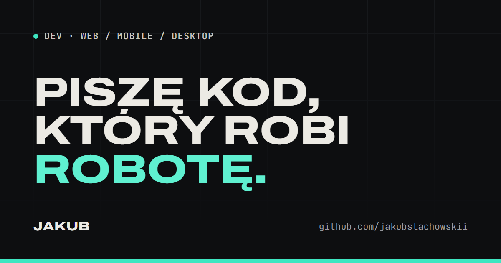

<div align="center">

# Jakub Stachowski — portfolio

Strona portfolio programisty: projekty pobierane prosto z GitHuba, wersja polska i angielska, jasny i ciemny motyw.

**[portfolio-jakubstachowskii.vercel.app](https://portfolio-jakubstachowskii.vercel.app)**

[](https://github.com/jakubstachowskii/portfolio/actions/workflows/ci.yml)


<a href="https://portfolio-jakubstachowskii.vercel.app"></a>

</div>

## Spis treści

- [O projekcie](#o-projekcie)
- [Funkcje](#funkcje)
- [Jakość](#jakość)
- [Technologie](#technologie)
- [Architektura](#architektura)
- [Uruchomienie](#uruchomienie)
- [Treść: projekty, dane, CV](#treść-projekty-dane-cv)
- [Wdrożenie](#wdrożenie-vercel)
- [Komendy](#komendy)
- [Konwencje](#konwencje)

## O projekcie

Statyczna strona zbudowana w Astro. Przy każdym buildzie pobiera publiczne repozytoria i kalendarz aktywności z API GitHuba, więc nowy projekt pojawia się na stronie bez zmian w kodzie. Codzienny automatyczny rebuild odświeża dane.

Domyślnie strona nie wysyła JavaScriptu poza kilkoma małymi skryptami do interakcji (łącznie ok. 4 KB po kompresji). Działa też z wyłączonym JavaScriptem.

## Funkcje

- **Projekty z GitHuba:** opis, technologie (topiki), platforma i link do wersji demo pobierane z repozytorium; opcjonalne nadpisanie w pliku markdown.
- **Podstrony projektów** z opisem, podglądem i nawigacją poprzedni / następny.
- **Aktywność na GitHubie:** kalendarz kontrybucji (GraphQL), liczba publicznych repozytoriów i ostatni commit.
- **Dwa języki:** polski i angielski, przełącznik prowadzi do tej samej strony w drugim języku; `hreflang` i osobne meta dla obu wersji.
- **Jasny i ciemny motyw** bez mignięcia przy ładowaniu; domyślnie według ustawień systemu.
- **Interaktywny hero** (talia kart z podglądami platform) i podgląd projektu po najechaniu, z wersją dla `prefers-reduced-motion`.
- **Kopiowanie adresu e-mail** jednym kliknięciem.

## Jakość

| Obszar         | Jak jest pilnowane                                                                                                                                                                                                                      |
| -------------- | --------------------------------------------------------------------------------------------------------------------------------------------------------------------------------------------------------------------------------------- |
| Wydajność      | Lighthouse CI w każdym PR (próg: wydajność ≥ 0.95, dostępność, dobre praktyki i SEO = 1.0); fonty z podzbiorem znaków i preloadem; obrazy przez `astro:assets`                                                                          |
| Dostępność     | WCAG 2.2 AA: axe w testach e2e w obu motywach, pełna obsługa klawiaturą z widocznym fokusem, link „przejdź do treści”, kontrast sprawdzany w obu motywach                                                                               |
| Bezpieczeństwo | Content Security Policy z hashami skryptów, nagłówki bezpieczeństwa (HSTS, `X-Frame-Options`, `Referrer-Policy`, `Permissions-Policy`, COOP i inne) generowane przy buildzie, token GitHuba tylko do odczytu i tylko po stronie serwera |
| Responsywność  | od 360 px do 1920 px, testowane automatycznie na 7 szerokościach                                                                                                                                                                        |
| Testy          | 135 testów jednostkowych (Vitest), testy e2e na desktopie i telefonie (Playwright + axe), `pnpm audit:site` do przeglądu działającej strony                                                                                             |
| Kod            | TypeScript `strictest`, ESLint, Prettier, Conventional Commits (commitlint), hooki git (lefthook)                                                                                                                                       |

## Technologie

| Warstwa      | Narzędzia                                                              |
| ------------ | ---------------------------------------------------------------------- |
| Framework    | [Astro 7](https://astro.build) (strona statyczna, Content Collections) |
| Język        | TypeScript (`strictest`)                                               |
| Style        | Tailwind CSS v4 (CSS-first, tokeny w `src/styles/tokens.css`)          |
| Treść        | Markdown + Content Collections ze schematami Zod                       |
| Dane         | GitHub REST API (repozytoria) i GraphQL API (kontrybucje)              |
| Testy        | Vitest, Playwright, axe-core, Lighthouse CI                            |
| Hosting i CI | Vercel, GitHub Actions (CI, codzienny rebuild, zrzuty referencyjne)    |
| Narzędzia    | pnpm, ESLint, Prettier, commitlint, lefthook                           |

## Architektura

```
src/
├── components/
│   ├── home/          # sekcje strony głównej (hero, projekty, o mnie, stack, GitHub, kontakt)
│   ├── project/       # podstrona projektu (nagłówek, treść, nawigacja)
│   ├── mocks/         # szkice aplikacji w podglądzie projektu
│   └── layout/        # nawigacja, stopka, SEO
├── config/site.ts     # dane właściciela, linki, ukryte repozytoria
├── content/projects/  # opcjonalne nadpisania i opisy projektów (PL: *.md, EN: *.en.md)
├── i18n/              # wszystkie teksty interfejsu (pl.ts, en.ts)
├── integrations/      # nagłówki bezpieczeństwa dla Vercela
├── lib/               # logika: pobieranie i łączenie danych z GitHuba, SEO, ścieżki
├── pages/             # trasy: /, /en/, /projekty/[slug], /en/projects/[slug], 404
└── styles/            # tokeny i style globalne
```

Przepływ danych przy buildzie: `lib/load-projects.ts` pobiera repozytoria z GitHuba → łączy je z nadpisaniami z `content/projects/` → strony generują listę i podstrony. Odpowiedzi API są zapisywane w pamięci podręcznej (`src/data/`), więc build działa także bez sieci i bez tokenu.

Zasady projektu (kolejność priorytetów, design system, konwencje) są w [`CLAUDE.md`](CLAUDE.md), decyzje architektoniczne w [`docs/DECISIONS.md`](docs/DECISIONS.md), postęp w [`docs/PROGRESS.md`](docs/PROGRESS.md).

## Uruchomienie

Wymagania: **Node 24 LTS** (`.nvmrc`) i **pnpm 12** (`corepack enable`).

```bash
pnpm install
pnpm dev          # http://localhost:4321
```

Bez zmiennych środowiskowych działa cała strona poza sekcją aktywności GitHub.

| Zmienna        | Po co                                                                                                                                | Bez niej                                                      |
| -------------- | ------------------------------------------------------------------------------------------------------------------------------------ | ------------------------------------------------------------- |
| `GITHUB_TOKEN` | Kalendarz kontrybucji (GraphQL wymaga tokenu) i wyższy limit zapytań. Token **fine-grained**, tylko odczyt publicznych repozytoriów. | Sekcja GitHub się nie pokazuje; projekty pobierają się dalej. |

Lokalnie: plik `.env` (wzór w `.env.example`, nigdy nie commituj `.env`). Na produkcji: zmienne środowiskowe w Vercelu.

## Treść: projekty, dane, CV

### Nowy projekt

Projekty to publiczne repozytoria z `github.com/jakubstachowskii`. Nic nie trzeba dopisywać w kodzie:

1. Wrzuć repozytorium na GitHuba.
2. W repozytorium kliknij **⚙ obok „About”** i uzupełnij:
   - **Description**: jedno–dwa zdania opisu (bez opisu brany jest pierwszy akapit README);
   - **Topics**: technologie (np. `react`, `sqlite`), które staną się tagami, oraz platforma `desktop`, `web` albo `mobile` (domyślnie `web`);
   - **Website**: adres działającej wersji, jeśli jest (pojawi się przycisk „ZOBACZ ↗”).
3. Przy następnym buildzie projekt jest na stronie; codzienny rebuild robi to sam.

Kolejność: najpierw projekty z polem `order`, potem według ostatniej aktywności.

### Nadpisanie i opis na podstronę

Plik `src/content/projects/<NazwaRepo>.md` (nazwa pliku = dokładna nazwa repozytorium) nadpisuje dane z GitHuba. Wszystkie pola są opcjonalne:

```markdown
---
title: 'Awizacja App' # zamiast nazwy repozytorium
summary: 'Opis po polsku na liście i w podglądzie.'
summaryEn: 'Description in English.'
platforms: [desktop] # desktop / web / mobile
tags: [Electron, React, SQLite]
mock: awizacja # szkic w podglądzie: awizacja / formatka / lotto / pig / generic
order: 1 # niżej = wyżej na liście
hidden: false # true = nie pokazuj
---

Dłuższy opis na podstronę projektu (markdown, po polsku).
```

Opis po angielsku: plik `src/content/projects/<NazwaRepo>.en.md` z samą treścią.

### Screenshot zamiast szkicu

- Obraz w `src/assets/projects/<NazwaRepo>.png` (albo `.jpg` / `.webp`) zastępuje szkic w podglądzie i na podstronie.
- Dla repozytoriów z ustawionym **Website**: `pnpm build && pnpm screenshots` robi zrzuty automatycznie.
- Bez screenshotu projekt dostaje uniwersalny szkic. Nowy szkic: komponent w `src/components/mocks/` według zasady z `ProjectMock.astro`.

### Ukrycie repozytorium

Dodaj repozytorium topik **`portfolio-hide`** albo dopisz jego nazwę do `hiddenRepos` w [`src/config/site.ts`](src/config/site.ts). Forki, repozytoria zarchiwizowane i to repozytorium są pomijane automatycznie.

### Dane, CV i zdjęcie

Dane kontaktowe są w [`src/config/site.ts`](src/config/site.ts). Dwie rzeczy pojawiają się dopiero po dodaniu plików:

- **CV:** PDF w `public/cv.pdf` i `cv: '/cv.pdf'` w `site.ts`; wtedy w hero pojawi się przycisk „CV.PDF ↓”.
- **Zdjęcie w „O mnie”:** plik `src/assets/about/photo.jpg` (albo `.png` / `.webp`; kwadrat, min. 400×400) pokaże się sam.

## Wdrożenie (Vercel)

Repozytorium jest podpięte do Vercela: każdy PR dostaje podgląd, a `main` trafia na produkcję.

1. **Strona publiczna:** Vercel → **Settings → Deployment Protection** → _Vercel Authentication_ wyłączone dla produkcji.
2. **Token:** Vercel → **Settings → Environment Variables** → `GITHUB_TOKEN` (jak wyżej) → _Save_, potem _Redeploy_.
3. **Codzienny rebuild:** Vercel → **Settings → Git → Deploy Hooks** → hook dla `main`. Na GitHubie: **Settings → Secrets and variables → Actions** → sekret `VERCEL_DEPLOY_HOOK` z adresem hooka. Workflow [`rebuild.yml`](.github/workflows/rebuild.yml) wywołuje go codziennie o 04:00 UTC (ręcznie: _Actions → Codzienny rebuild → Run workflow_).
4. **Własna domena:** Vercel → **Settings → Domains** → dodaj domenę i ustaw rekordy DNS według instrukcji Vercela, potem zmień `site` w [`astro.config.mjs`](astro.config.mjs). Na adresie `*.vercel.app` Vercel dodaje nagłówek `X-Robots-Tag: noindex`, więc wyszukiwarki indeksują stronę dopiero na własnej domenie.

Nagłówki bezpieczeństwa i CSP powstają przy buildzie (`src/integrations/security-headers.ts`, `security.csp` w konfiguracji Astro); w Vercelu nie trzeba nic ustawiać.

## Komendy

| Komenda             | Co robi                                                                                    |
| ------------------- | ------------------------------------------------------------------------------------------ |
| `pnpm dev`          | serwer deweloperski                                                                        |
| `pnpm build`        | build produkcyjny                                                                          |
| `pnpm preview`      | podgląd builda                                                                             |
| `pnpm check`        | `astro check` (typy)                                                                       |
| `pnpm lint`         | `astro sync` + ESLint + `prettier --check`                                                 |
| `pnpm format`       | `prettier --write`                                                                         |
| `pnpm test`         | testy jednostkowe (Vitest)                                                                 |
| `pnpm test:e2e`     | Playwright + axe (sam buduje i uruchamia stronę; wcześniej zatrzymaj `pnpm dev`)           |
| `pnpm lhci`         | Lighthouse CI na zbudowanym `dist/`                                                        |
| `pnpm audit:site`   | przegląd działającej strony: lokalnie po `pnpm preview` albo `pnpm audit:site https://…`   |
| `pnpm ci:local`     | **wszystkie kroki CI na czystej kopii ostatniego commitu**; uruchamiaj przed każdym pushem |
| `pnpm screenshots`  | zrzuty stron repozytoriów z ustawionym Website → `src/assets/projects/`                    |
| `pnpm brand`        | ikona Apple i obrazek Open Graph z `scripts/brand.html`                                    |
| `pnpm fonts:subset` | podzbiory fontów w `src/assets/fonts/` (po zmianie zakresów znaków)                        |

<details>
<summary>Lighthouse CI lokalnie na Windowsie</summary>

Jeśli `lhci` zgłasza `spawn UNKNOWN`, wskaż headless shell z Playwrighta:

```powershell
$env:CHROME_PATH = (Get-ChildItem "$env:LOCALAPPDATA\ms-playwright" -Recurse -Filter chrome-headless-shell.exe | Select-Object -First 1).FullName
pnpm lhci
```

</details>

## Konwencje

- Commity według [Conventional Commits](https://www.conventionalcommits.org/pl/) (`feat:`, `fix:`, `docs:`, `test:`…), pilnuje ich commitlint w hooku `commit-msg`.
- Jedna zmiana = jedna gałąź = jeden PR; przed pushem `pnpm ci:local`.
- Teksty interfejsu tylko w `src/i18n/`, treść tylko w `src/content/`, wartości wizualne tylko z tokenów.

Fonty (Archivo, Inter, JetBrains Mono) są na licencji SIL Open Font License, szczegóły w [`public/licenses/fonts.txt`](public/licenses/fonts.txt).
