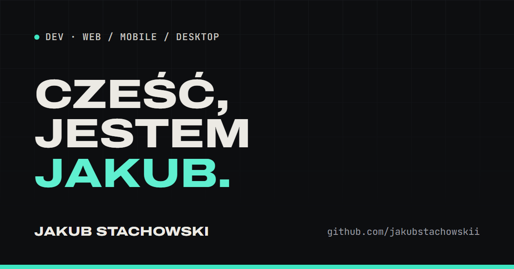

# Jakub Stachowski — portfolio

Moje portfolio programisty: projekty, krótko o mnie, technologie, CV i kontakt.

**[portfolio-jakubstachowskii.vercel.app](https://portfolio-jakubstachowskii.vercel.app)**

## Co jest na stronie

- **Projekty** pobierane prosto z moich publicznych repozytoriów na GitHubie, z podglądem, zrzutami ekranu i osobną podstroną dla każdego projektu. Nowy projekt pojawia się na stronie bez zmian w kodzie.
- **O mnie**: kilka zdań o tym, czego się uczę i czego szukam.
- **Stack**: technologie, których używam na co dzień.
- **Aktywność na GitHubie**: kalendarz kontrybucji i ostatni commit.
- **CV** do otwarcia jednym kliknięciem z menu, z hero i z sekcji Kontakt.
- **Kontakt**: kopiowanie adresu e-mail, GitHub i LinkedIn.

## Projekty

| Projekt | Platforma | Technologie |
| ------- | --------- | ----------- |
| [AwizacjaApp](https://github.com/jakubstachowskii/AwizacjaApp) | Desktop | Electron, React, SQLite |
| [FormatkaApp](https://github.com/jakubstachowskii/FormatkaApp) | Desktop | Electron, React, Vite, SQLite |
| [LottoAnalyzer](https://github.com/jakubstachowskii/LottoAnalyzer) | Desktop | Electron, JavaScript |
| [Trening App](https://github.com/jakubstachowskii/trening-app) *(w trakcie)* | Mobile | React Native, Expo, TypeScript, SQLite |

## Jak strona jest zrobiona

- **Wersja polska i angielska**, przełącznik prowadzi do tej samej strony w drugim języku.
- **Jasny i ciemny motyw** bez mignięcia przy ładowaniu, domyślnie według ustawień systemu.
- **Interaktywny hero**: talia kart z typami aplikacji, obsługiwana myszą, klawiaturą i dotykiem.
- **Działa na każdym ekranie**, od małego telefonu po duży monitor.
- **Szybka**: prawie bez JavaScriptu (ok. 4 KB po kompresji), wynik 100 w Lighthouse za wydajność.
- **Dostępna**: zgodna z WCAG 2.2 AA, pełna obsługa klawiaturą, czytelna dla czytników ekranu, szanuje ustawienie ograniczonego ruchu.
- **Bezpieczna**: polityka CSP i nagłówki bezpieczeństwa, bez zewnętrznych skryptów śledzących.

## Jakość

- 140 testów jednostkowych (Vitest) i testy e2e na komputerze i telefonie (Playwright + axe).
- Lighthouse CI w każdym PR: wydajność ≥ 95, dostępność, dobre praktyki i SEO 100.
- TypeScript w najostrzejszym trybie, ESLint, Prettier, Conventional Commits.
- Każda zmiana przez pull request z zielonym CI.

## Technologie

Astro 7 · TypeScript · Tailwind CSS 4 · Markdown + Content Collections · GitHub API · Vitest · Playwright · Lighthouse CI · GitHub Actions · Vercel

---

Fonty (Archivo, Inter, JetBrains Mono) są na licencji SIL Open Font License, szczegóły w [`public/licenses/fonts.txt`](public/licenses/fonts.txt).
